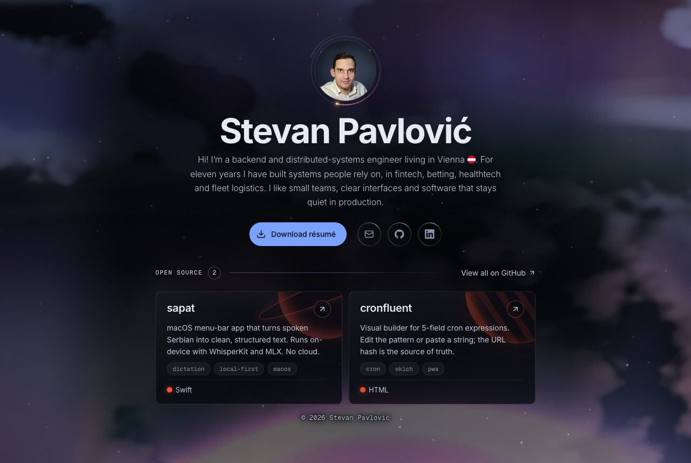
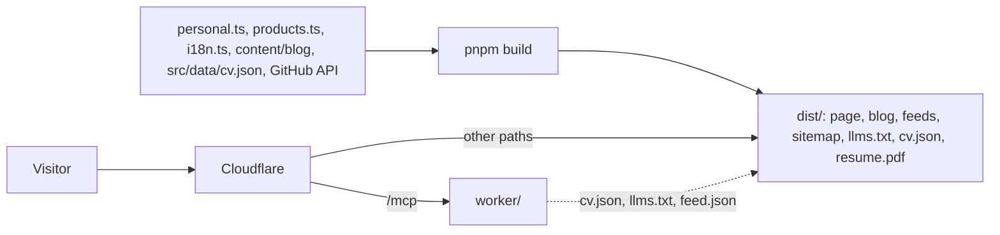

# stevanpavlovic.com

My personal site: one contact card floating over a live WebGL sky, a small blog under the same sky, and a Worker that answers questions about my CV and posts.



**Live:** [stevanpavlovic.com](https://stevanpavlovic.com)

## What is in it

- **One sky.** A hand-written WebGL night sky behind the card and the blog. The real Vienna sun sits where it truly is; going to the blog, it glides to the top-left corner and becomes the blog's corona.
- **Shooting stars.** One every few seconds from the top-left, with a bright head and a cooling trail.
- **A glass bead.** It follows the cursor over the portrait (a finger after a press and hold) and magnifies the photo with chromatic edges, in the card and in the portrait dialog.
- **A name that tunes in.** A CSS signal intro, then every 8 s a WebGL tear and a weight-morph wave across the letters.
- **A work page.** [/work](https://stevanpavlovic.com/work) lists the open-source repos, each with a CSS planet and language chips in GitHub's colors.
- **One product beside the code.** Safety Real Time sits under the repos on /work. Its logo is a flat mark in a ring.
- **Vienna on a globe.** Click "Vienna" in the bio for the coat of arms, a few facts and a three.js globe that loads only then.
- **A blog under the same sky.** [/blog](https://stevanpavlovic.com/blog) puts one moon around my portrait for each post and links posts that share a tag. Each post has its own sky in the header. Posts are MDX with charts, diagrams and shader stills, optimized at build time, with RSS and JSON feeds and a Markdown copy for AI tools.
- **Kind to your device.** Every loop drops to 30 fps when idle, pauses when hidden, degrades on slow frames and draws one still frame under reduced motion or a software renderer. A "Stop motion" button in the footer stills everything and remembers it.
- **No cookies.** Cloudflare Web Analytics counts visits without them, and a small chip says so once.

## How it works



The site is an Astro 7 static build (React 19 islands for the sky and the card, Tailwind v4), written to `dist/` with one HTML file per page. The Worker in `worker/` runs only for `/mcp`. `POST /mcp` is a read-only MCP server with eight tools (`profile`, `experience`, `skills`, `projects`, `products`, `contact`, `posts`, `post`) behind a per-IP rate limit. It reads `/cv.json`, `/llms.txt` and `/blog/feed.json` from the static assets. The build makes `/cv.json` and `/resume.pdf` from the committed résumé in `src/data/cv.json`, which holds no phone number; data that fails the schema fails the build.

## Getting started

Node 24 and pnpm 12. The build reads the GitHub API and needs `GITHUB_TOKEN`; locally it falls back to `gh auth token`. The résumé PDF is built from `src/data/cv.json`, not committed.

```bash
pnpm install
pnpm dev   # http://localhost:4321
```

| Script               | What it does                                                                  |
| -------------------- | ----------------------------------------------------------------------------- |
| `pnpm dev`           | Builds the blog media, then a dev server on port 4321 (drafts show)           |
| `pnpm build`         | Builds the blog media and `dist/`, then runs the preload and meta guards      |
| `pnpm preview`       | Serves `dist/` with `astro preview` on port 4321                              |
| `pnpm check`         | Format, lint, `astro check`, Worker types, tests, unused code, build, profile |
| `pnpm fix`           | Applies Prettier and ESLint fixes                                             |
| `pnpm icons`         | Rebuilds `src/lib/icon-data.ts`                                               |
| `pnpm profile:build` | Builds the GitHub profile into `.profile-out/` (`--check` also checks links)  |

`pnpm check` changes no file. It runs before every commit (husky) and in CI.

## GitHub profile

The README on [github.com/pavstev](https://github.com/pavstev) is generated here by `src/profile/` from the same data and repo list as the site. `.github/workflows/profile.yml` pushes it to `pavstev/pavstev` on relevant pushes, daily and by hand (`dry_run` shows the diff). Never edit that repo by hand. The workflow needs a deploy key, set up once:

```bash
ssh-keygen -t ed25519 -N "" -C "profile-sync" -f /tmp/profile_sync
gh repo deploy-key add /tmp/profile_sync.pub -R pavstev/pavstev --allow-write -t "website profile sync"
gh secret set PROFILE_DEPLOY_KEY -R pavstev/website < /tmp/profile_sync && rm /tmp/profile_sync*
```

## Deploy

Every push to `main` makes Cloudflare build the repo and publish `dist/` with the Worker (`wrangler.jsonc`; hashed bundles in `dist/_astro/` are cached for a year by `public/_headers`). Cloudflare runs `pnpm run build` and needs `GITHUB_TOKEN` as a build variable. The `workers.dev` URL and branch previews are off. A blog post with a future `date` goes live at 00:00 Vienna time on that day: `.github/workflows/blog-publish.yml` checks every 15 minutes and, when a post is due, starts a build through a Cloudflare deploy hook (the secret `CLOUDFLARE_DEPLOY_HOOK`). Nobody deploys by hand.

## Contact

Found a bug or want to say hello? Write to [hi@stevanpavlovic.com](mailto:hi@stevanpavlovic.com).

## License

The code is under the [MIT License](LICENSE). The portraits, the résumé and the personal text are not covered by it: see [NOTICE](NOTICE).
